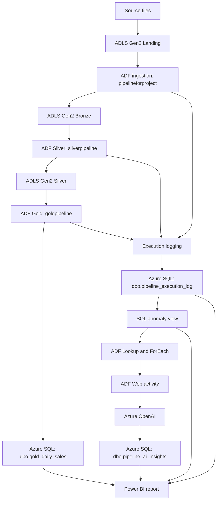

# AI-Powered Data Engineering & Pipeline Observability Platform

An Azure-based data engineering and observability portfolio project combining metadata-driven ingestion, Bronze–Silver–Gold processing, SQL execution logging, rule-based anomaly detection, Azure OpenAI incident analysis, and Power BI reporting.

> Before publishing, replace environment-specific placeholders and confirm the final deployed pipeline orchestration. Never commit API keys, passwords, connection strings, access tokens, or sensitive identifiers.

## Overview

Source files are ingested into Azure Data Lake Storage Gen2 (ADLS Gen2), transformed through Bronze, Silver, and Gold layers using Azure Data Factory (ADF), and aggregated into Azure SQL Database. SQL execution logs and an anomaly view identify failed or unusually slow pipeline runs. An ADF Web activity calls Azure OpenAI to generate a likely cause and recommended troubleshooting actions. The findings are saved to SQL and visualized with operational and business metrics in Power BI.

## Business problem

Data pipelines can fail because of missing files, incorrect paths, invalid data, upstream delays, or configuration issues. Without centralized monitoring, engineers often inspect individual runs and logs manually. This project brings data processing, execution logging, rule-based anomaly detection, AI-assisted troubleshooting, and reporting into one solution.

## Architecture



Gold aggregates are written directly to `dbo.gold_daily_sales` in Azure SQL; a separate Gold CSV output is not required for the report.

## Technology stack

| Technology | Purpose |
|---|---|
| Azure Data Factory | Ingestion, transformation, orchestration, Lookup, ForEach, Web and Stored Procedure activities |
| ADLS Gen2 | Landing, Bronze, Silver and reject storage |
| Azure SQL Database | Configuration, execution logs, anomaly view, AI insights and Gold aggregates |
| Azure OpenAI | AI-assisted incident analysis |
| Power BI | Operational and business dashboards |
| SQL/T-SQL and DAX | Data logic, logging, anomaly queries, persistence and reporting measures |

## Data flow

1. Source files arrive in the ADLS Gen2 landing area.
2. `pipelineforproject` copies configured files into Bronze, using metadata and parameterized datasets where configured.
3. `silverpipeline` cleans and transforms Bronze data, applying the validation rules configured in the data flow.
4. `goldpipeline` aggregates Silver data and writes daily sales metrics to `dbo.gold_daily_sales`.
5. Pipeline execution metadata is recorded in `dbo.pipeline_execution_log`.
6. `dbo.vw_pipeline_anomalies` classifies failed runs and identifies slow runs using historical duration rules.
7. `pipeline_ai_analyzer` reads anomaly records, loops through incidents, calls Azure OpenAI, and saves generated analysis to `dbo.pipeline_ai_insights`.
8. Power BI displays pipeline health, anomaly details, AI findings, and sales KPIs.

## ADF pipelines

### `pipelineforproject` — ingestion
Reads source configuration from `dbo.ingestion_config` and copies configured source files from Landing into Bronze. Parameterized datasets allow file names and paths to be supplied dynamically.

### `silverpipeline` — Silver transformation
Reads Bronze data, applies the configured transformations and data-quality rules, and writes cleaned data to Silver. Describe specific validation/rejection rules according to the final implementation.

### `goldpipeline` — Gold aggregation
Reads Silver data, calculates business aggregates, and writes results to `dbo.gold_daily_sales` in Azure SQL.

### `pipeline_ai_analyzer` — AI incident analysis
Uses Lookup to query `dbo.vw_pipeline_anomalies`, ForEach to process incidents, a Web activity to call Azure OpenAI, and a Stored Procedure activity to save the analysis.

### `master_data_pipeline` — parent orchestration (include only if deployed and tested)
If this parent pipeline is deployed and validated, it executes ingestion, Silver, and Gold in sequence using Execute Pipeline activities and success dependencies. If those pipelines are still run separately, do not claim end-to-end parent orchestration.

## SQL objects

| Object | Purpose |
|---|---|
| `dbo.ingestion_config` | Metadata-driven source configuration |
| `dbo.pipeline_execution_log` | Run ID, pipeline name, start/end time, duration, status and error details |
| `dbo.log_pipeline_execution` | Stored procedure for inserting execution log entries |
| `dbo.vw_pipeline_anomalies` | Identifies failures and slow runs |
| `dbo.pipeline_ai_insights` | Persists AI analysis, severity and recommended actions |
| `dbo.save_pipeline_ai_insight` | Inserts or updates an insight by source log ID |
| `dbo.gold_daily_sales` | Gold-layer daily sales aggregates |

### Inspect execution logs

```sql
SELECT pipeline_name, run_id, start_time, end_time,
       duration_seconds, status, error_message
FROM dbo.pipeline_execution_log
ORDER BY logged_at DESC;
```

### Inspect anomalies

```sql
SELECT *
FROM dbo.vw_pipeline_anomalies
WHERE anomaly_type IN ('PIPELINE_FAILURE', 'SLOW_PIPELINE')
ORDER BY logged_at DESC;
```

The view classifies failed runs as `PIPELINE_FAILURE`. Slow-run detection compares duration with a rolling average of prior runs; the threshold and minimum history count are defined in the view.

### Inspect AI insights

```sql
SELECT source_log_id, pipeline_name, run_id, anomaly_type,
       severity, incident_summary, likely_cause,
       recommended_actions, analyzed_at
FROM dbo.pipeline_ai_insights
ORDER BY analyzed_at DESC;
```

### Inspect Gold results

```sql
SELECT order_day, order_count, total_units, gross_order_amount
FROM dbo.gold_daily_sales
ORDER BY order_day;
```

## AI incident analysis

The analyzer passes incident context—pipeline name, run ID, status, duration, anomaly type and error message—to Azure OpenAI through an ADF Web activity. The Responses API returns JSON; the `resp_...` response ID is metadata, not the generated diagnosis. The text is nested in the response output and must be extracted before persistence.

The current parsing implementation was built around Markdown-style headings such as `Severity:`, `Likely Cause:`, and `Recommended Troubleshooting Actions:`. For a production version, request strict JSON from the model and validate the schema before storing fields. AI-generated causes are hypotheses to assist troubleshooting, not verified root causes.

## Power BI dashboard

The report uses `pipeline_execution_log`, `vw_pipeline_anomalies`, `pipeline_ai_insights`, and `gold_daily_sales`.

### Page 1 — Executive Overview
- Total runs, successful runs, failed runs and success rate
- Average execution duration and anomaly count
- Daily gross sales
- Failed runs by pipeline

### Page 2 — Pipeline Monitoring
- Execution history table
- Duration trend
- Failed and slow runs
- Slicers for pipeline, status and date

### Page 3 — AI Insights & Sales
- AI severity, incident summary, likely cause and recommended actions
- Gold sales, total orders and total units
- Daily sales trend

Example DAX measures (adjust names/status values to match your model):

```DAX
Total Runs = COUNTROWS(pipeline_execution_log)
```

```DAX
Failed Runs =
CALCULATE(
    COUNTROWS(pipeline_execution_log),
    pipeline_execution_log[status] = "Failed"
)
```

```DAX
Successful Runs =
CALCULATE(
    COUNTROWS(pipeline_execution_log),
    pipeline_execution_log[status] = "Succeeded"
)
```

```DAX
Success Rate % = DIVIDE([Successful Runs], [Total Runs], 0)
```

```DAX
Average Duration (Seconds) =
AVERAGE(pipeline_execution_log[duration_seconds])
```

```DAX
Anomaly Count =
CALCULATE(
    COUNTROWS(vw_pipeline_anomalies),
    vw_pipeline_anomalies[anomaly_type]
        IN {"PIPELINE_FAILURE", "SLOW_PIPELINE"}
)
```

```DAX
Gross Sales = SUM(gold_daily_sales[gross_order_amount])
Total Orders = SUM(gold_daily_sales[order_count])
Total Units = SUM(gold_daily_sales[total_units])
```

Validate Power BI totals against SQL. With Import mode, refresh the semantic model to load newer records. Publishing and scheduled refresh depend on licensing, workspace capacity, credentials and network configuration.

## Suggested GitHub repository structure

```text
ai-powered-data-engineering-observability/
├── README.md
├── architecture/
│   └── architecture.mmd
├── sql/
│   ├── create_ingestion_config.sql
│   ├── create_pipeline_execution_log.sql
│   ├── create_log_pipeline_execution.sql
│   ├── create_vw_pipeline_anomalies.sql
│   ├── create_pipeline_ai_insights.sql
│   ├── create_save_pipeline_ai_insight.sql
│   └── test_incident_data.sql
├── adf/
│   ├── pipeline-documentation.md
│   └── screenshots/
├── power-bi/
│   ├── screenshots/
│   └── measures.dax
├── sample-data/
│   └── README.md
└── docs/
    ├── setup.md
    ├── testing.md
    └── cost-and-cleanup.md
```

Only add files you actually have. Include exported ADF JSON only after removing secrets and environment-specific details. Add Power BI screenshots; do not commit a `.pbix` file if it contains credentials or sensitive data.

## Setup and deployment

1. Create/use an Azure resource group, ADLS Gen2 account, Azure SQL Database and ADF instance.
2. Create the ADLS container and required folders, such as `landing`, `bronze`, `silver`, `reject`, and `archive`.
3. Configure linked services and datasets for ADLS Gen2 and Azure SQL.
4. Create and populate `dbo.ingestion_config`.
5. Deploy and test ingestion, Silver and Gold pipelines separately.
6. Create the execution log table and logging stored procedure; configure logging for success and failure paths.
7. Create the anomaly view and validate it with a controlled test incident.
8. Create the AI insights table and stored procedure.
9. Deploy an Azure OpenAI model and configure the ADF Web activity. Use Key Vault or managed identity where supported; never hardcode secrets in Git.
10. Configure the AI analyzer Lookup → ForEach → Web → Stored Procedure flow.
11. Connect Power BI to Azure SQL, build the report pages and compare measures against SQL.
12. Publish only after testing permissions, credentials and costs.

Resource names, endpoints, model deployment names and authentication settings differ by environment; document yours without publishing secrets.

## Testing checklist

1. Insert a clearly labeled temporary incident into `dbo.pipeline_execution_log`.
2. Verify `dbo.vw_pipeline_anomalies` classifies it as `PIPELINE_FAILURE`.
3. Run `pipeline_ai_analyzer` and verify Lookup returns the test incident.
4. Confirm the Web activity returns generated text, not just a response ID.
5. Verify readable AI fields are saved in `dbo.pipeline_ai_insights`.
6. Confirm repeat processing updates the record for the same `source_log_id`.
7. Refresh Power BI and verify the test incident appears in the appropriate visuals.
8. Remove temporary test records only after successful validation.

## Security and cost

- Never commit API keys, SQL passwords, access tokens, connection strings or storage keys.
- Rotate any credential exposed in a screenshot or repository.
- Prefer Key Vault or managed identity where supported.
- Restrict SQL firewall rules and database permissions.
- Start with a small number of AI test requests.
- Review Azure Cost Management, Azure OpenAI usage, ADF activity runs, SQL compute and Power BI licensing/capacity.
- Remove temporary test records and unused cloud resources after testing.

## Limitations and future improvements

- AI diagnosis is advisory and must be validated by an engineer.
- Markdown-heading parsing is less reliable than schema-validated JSON.
- Slow-run detection is rule-based and needs sufficient history.
- Logging coverage depends on success/failure branches configured in each pipeline.
- Production enhancements could include retries, alerting, retention policies, failure monitoring for the logging path, schema-validated AI responses, and Power BI row-level security.

## Resume title and description

**Project title:** AI-Powered Data Engineering & Pipeline Observability Platform

**Resume bullet:**

Built an Azure-based data engineering platform using Azure Data Factory, ADLS Gen2 and Azure SQL to implement metadata-driven ingestion, Bronze–Silver–Gold processing, execution logging and SQL-based detection of failed or slow pipelines; integrated Azure OpenAI to generate incident explanations and troubleshooting recommendations, and developed Power BI dashboards for pipeline health, AI insights and Gold-layer sales KPIs.

**Keywords:** Azure Data Factory, ADLS Gen2, Azure SQL Database, Azure OpenAI, Power BI, DAX, T-SQL, ETL/ELT, metadata-driven ingestion, medallion architecture, Bronze/Silver/Gold, data quality, stored procedures, SQL views, window functions, pipeline orchestration, execution logging, anomaly detection, REST API integration, JSON parsing, operational observability, root-cause analysis support.

## Overall project paragraph

This project implements an end-to-end Azure data engineering and observability platform that ingests source files into ADLS Gen2, transforms data through Bronze, Silver and Gold layers using Azure Data Factory, and stores business aggregates in Azure SQL Database. It records pipeline execution metadata and applies SQL-based rules to identify failed and unusually slow runs. Azure OpenAI is integrated through an ADF Web activity to analyze incident context and suggest likely causes and troubleshooting actions, with results persisted in SQL. A Power BI report combines operational KPIs, anomaly details, AI-generated insights and sales metrics to provide a consolidated view of pipeline health and business outcomes.
